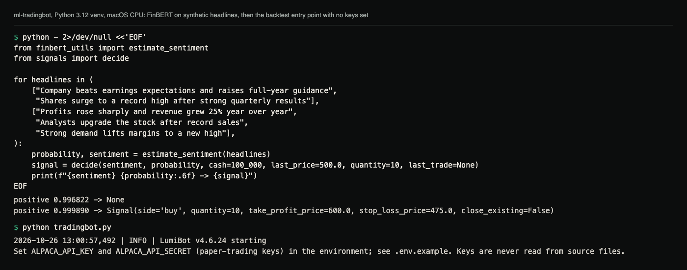
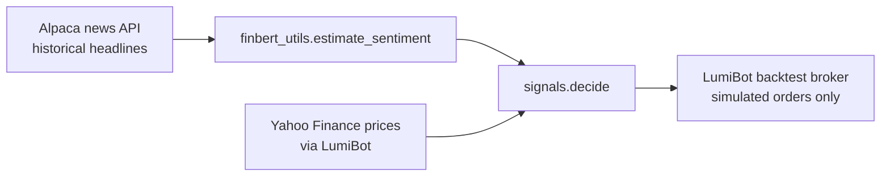

# ML Trading Bot with FinBERT Sentiment (educational backtest)

[](https://github.com/hellpuffyt/ml-tradingbot/actions/workflows/ci.yml)

A sentiment-driven strategy for one stock symbol (SPY by default): it scores recent news headlines with
[FinBERT](https://huggingface.co/ProsusAI/finbert) and runs a **simulated backtest** with
[LumiBot](https://github.com/Lumiwealth/lumibot) on historical Yahoo Finance prices.

[Case study ↗](https://hellpuff.dev/work/ml-tradingbot)

> ## Risk disclaimer: read first
> - **Educational/experimental code. Not financial advice. Not production-ready.**
> - The only thing `tradingbot.py` does is a **simulated backtest**. It contains **no live-trading path** and never
>   sends orders to a broker. It refuses to start if `ALPACA_PAPER` is set to false.
> - No performance or returns are claimed. A backtest of a strategy with a 99.9 % confidence threshold, a single
>   symbol and three days of headlines is not evidence that it would make money. Past (simulated) results do not
>   predict future results; trading can lose all of the money involved.
> - If you adapt this code to trade, you do so at your own risk; use a paper account and review every line first.

Based on Nicholas Renotte's tutorial project [nicknochnack/MLTradingBot](https://github.com/nicknochnack/MLTradingBot).

## Demo



Real output from a Python 3.12 venv on a CPU-only Mac, with no Alpaca keys
set. The first command runs the real FinBERT model and the real
`signals.decide()` on made-up headlines; it needs no keys, only the
FinBERT download. It shows how strict the 0.999 threshold is: two
clearly positive headlines score 0.9968 and the strategy holds. The second
command shows the backtest refusing to start without keys. A full backtest
needs Alpaca paper keys for the news API and was not run for this capture.

```sh
python - 2>/dev/null <<'EOF'
from finbert_utils import estimate_sentiment
from signals import decide

for headlines in (
    ["Company beats earnings expectations and raises full-year guidance",
     "Shares surge to a record high after strong quarterly results"],
    ["Profits rose sharply and revenue grew 25% year over year",
     "Analysts upgrade the stock after record sales",
     "Strong demand lifts margins to a new high"],
):
    probability, sentiment = estimate_sentiment(headlines)
    signal = decide(sentiment, probability, cash=100_000, last_price=500.0, quantity=10, last_trade=None)
    print(f"{sentiment} {probability:.6f} -> {signal}")
EOF
```

```text
positive 0.996822 -> None
positive 0.999890 -> Signal(side='buy', quantity=10, take_profit_price=600.0, stop_loss_price=475.0, close_existing=False)
```

`2>/dev/null` hides the model-loading progress bar and a PyTorch notice on
stderr. Scores can differ slightly in the last digits across hardware and
library versions.

## How it works
1. Every simulated trading day, fetch the last 3 days of headlines for the symbol from Alpaca's historical **news
   data** API (read-only; needs free Alpaca **paper** API keys).
2. FinBERT scores all headlines together (logits summed, then softmax) and returns one label (`positive`,
   `negative` or `neutral`) with its probability. No headlines means `neutral`, so the strategy holds.
3. `signals.decide()` turns that into an order:

| Sentiment | Probability | Action (simulated) | Take profit | Stop loss |
|---|---|---|---|---|
| positive | > 0.999 | close any short, then bracket **buy** | +20 % | -5 % |
| negative | > 0.999 | close any long, then bracket **sell** (short) | -20 % | +5 % |
| anything else | | hold | | |

Position size: whole shares worth `cash_at_risk` (default 5 %) of available cash. If that is less than one share, or
cash does not exceed the last price, it holds.



## Features
**Implemented**
- FinBERT headline sentiment (`finbert_utils.py`; model loaded lazily, CPU or CUDA).
- Bracket-order strategy with position sizing (`signals.py`, `tradingbot.py`).
- LumiBot backtest on Yahoo Finance data, configurable symbol, dates and cash-at-risk from the command line.
- Credentials from environment variables only; live trading explicitly refused.

**Not implemented** (earlier versions of this README implied otherwise)
- Live or paper *trading* (running the strategy against a broker in real time). Only backtesting exists.
- Real-time news / WebSocket streaming, multi-symbol portfolios, technical indicators, dashboards.

## Quick start
Requires Python 3.12 (the pinned dependency set was verified on 3.12) and free Alpaca paper API keys.
```bash
git clone https://github.com/hellpuffyt/ml-tradingbot.git && cd ml-tradingbot
python3.12 -m venv venv && source venv/bin/activate
pip install -r requirements.txt
export ALPACA_API_KEY=... ALPACA_API_SECRET=...   # paper keys, see .env.example
python tradingbot.py --start 2025-04-02 --end 2026-03-31
```
On Linux, `pip install -r requirements.txt` pulls the CUDA build of torch (several GB). For CPU only, install
`torch==2.14.1 --index-url https://download.pytorch.org/whl/cpu` first, as CI does. QUICKSTART.md has the same
steps with common errors.

The first run downloads FinBERT (~438 MB) into the Hugging Face cache. LumiBot writes its backtest reports to
`logs/` (git-ignored). `python tradingbot.py --help` lists the options (`--symbol`, `--cash-at-risk`, `--start`, `--end`).

Without keys it stops before doing anything:
```
$ python tradingbot.py
2026-10-22 20:19:01,750 | INFO | LumiBot v4.6.24 starting
Set ALPACA_API_KEY and ALPACA_API_SECRET (paper-trading keys) in the environment; see .env.example. Keys are never read from source files.
```

## Configuration
| Variable | Meaning |
|---|---|
| `ALPACA_API_KEY`, `ALPACA_API_SECRET` | Alpaca **paper** keys; used only to read historical news |
| `ALPACA_PAPER` | must be unset or `true`; `false`, `0`, `no` or `off` makes the program exit |

Strategy constants (threshold, bracket percentages) are at the top of `signals.py`.

## Testing
```bash
pip install -r requirements-dev.txt
python -m pytest
```
32 tests. They cover the signal logic, position sizing, credential handling, safety guards (no live endpoint, no live trader,
no credentials in source) and the strategy's order wiring with stubbed broker methods. The FinBERT test uses a tiny
random **stand-in** model (`hf-internal-testing/tiny-random-BertForSequenceClassification`) to check the code path
only; it needs network access to the Hugging Face Hub and says nothing about FinBERT's accuracy. A full backtest with
real FinBERT and real Alpaca news was **not** run during the audit (no keys); see
[docs/PRODUCTION_READINESS.md](docs/PRODUCTION_READINESS.md).

## Security
Never put keys in source files; use environment variables. A previous commit in this repository's history contained
API keys; they must be treated as compromised (see [SECURITY.md](SECURITY.md)). Report vulnerabilities via
[GitHub private advisories](https://github.com/hellpuffyt/ml-tradingbot/security/advisories/new).

## Limitations
- Sentiment from headlines alone; FinBERT is a 2019 model; 512-token limit per headline.
- One symbol, daily iterations, no transaction-cost model beyond LumiBot's defaults.
- Shorting in the backtest assumes shares can always be borrowed.

## Contributing
See [CONTRIBUTING.md](CONTRIBUTING.md). Changes are listed in [CHANGELOG.md](CHANGELOG.md).

## License
MIT, with an educational-use disclaimer appended. See [LICENSE](LICENSE).
